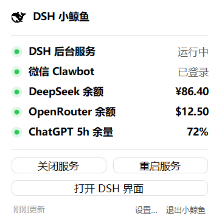

# DSH 小鲸鱼 🐋

照看 DeepSeek Harness 的桌面助手，保留 macOS 1.1.1，并增加 Windows 原生托盘版本。

| 目录 | 内容 |
|---|---|
| `mac/` | 原版 Swift 应用、macOS 资源和打包脚本 |
| `windows/` | Windows C# 应用、图标、启动器和测试 |
| `shared/` | 可选 DSH 余额/OAuth 插件及公共测试 |

## macOS

要求 macOS 13+ 和 Xcode 命令行工具。原有命令继续可用：

```bash
scripts/build-app.sh --install
scripts/install-launchagent.sh
```

应用打包在 `mac/build/DSHWhale.app`。1.1.1 中“网页 App 进程存在但无窗口时重新打开”的修复完整保留。使用说明见 [macOS 文档](mac/README.md)。

## Windows

要求 Windows、Node.js 和可用的 DSH；无需额外安装 .NET SDK。

```powershell
powershell -ExecutionPolicy Bypass -File .\windows\scripts\build-windows.ps1
powershell -ExecutionPolicy Bypass -File .\windows\scripts\setup-windows.ps1
```

双击 `windows/启动小鲸鱼.vbs` 显示面板，或 `windows/启动 DSH.vbs` 后台启动服务并打开网页。服务已运行时直接复用。设置页支持路径、自启动、余额来源和 ChatGPT 登录。



完整说明见 [Windows 文档](windows/README.md)。共享插件是可选安装项，安装脚本会先备份 DSH web profile；不重装 DSH、不替换其模型引擎。

## 验证与发行

```powershell
powershell -ExecutionPolicy Bypass -File .\windows\scripts\test-windows.ps1
node --test .\shared\tests\balances.test.mjs
powershell -ExecutionPolicy Bypass -File .\windows\scripts\package-windows.ps1
```

Windows 包在 `windows/dist/DSHWhale-Vibe-Windows.zip`。GitHub Actions 分别构建 macOS 和 Windows 并提供下载附件；维护者推送 `v*` 标签时，在两个平台构建通过后发布到 Release。

版本基线、增加内容、测试边界和已知限制见 [Windows 更新说明](CHANGELOG-Windows.md)。平台图形界面各用原生控件；ChatGPT 额度查询依赖实验性 Codex 接口，目前只验证了 Windows。

## License

[MIT](LICENSE)，保留 Alphainfix 的原始版权与许可。Windows 蓝色鲸鱼图标为本次移植新增的生成式图像资源。
